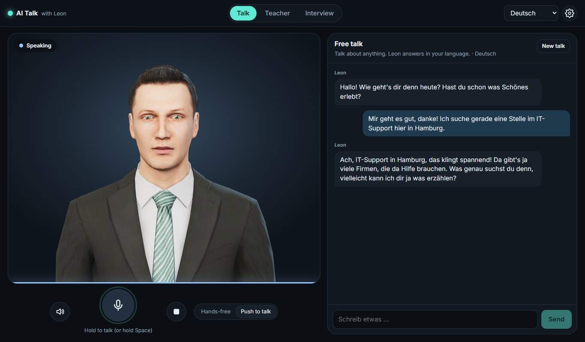
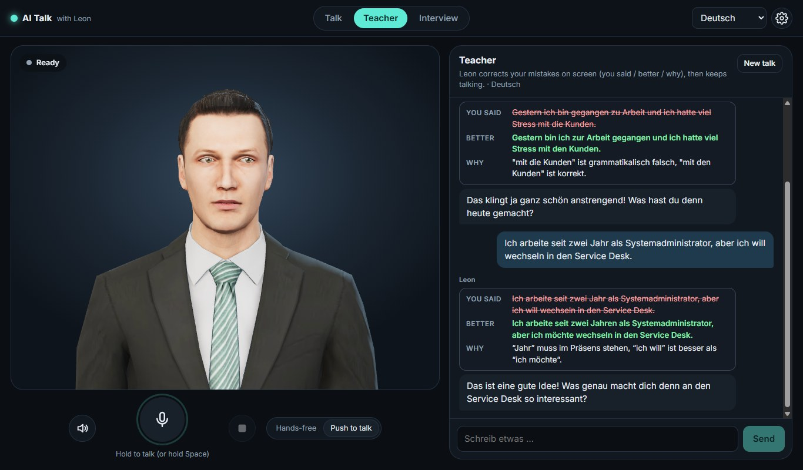
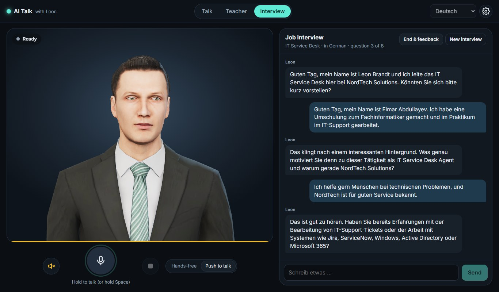

# AI Talk

**Talk with an AI by voice, face to face.**
AI Talk is a browser app with a talking 3D avatar called Leon. You speak, Leon listens, thinks and answers with his
voice, and his lips move with the words. Two AIs, switchable in the settings:

- **Claude (Cloud)**: Claude Opus 5.5 through the Anthropic API, the main AI when an API key is set. Best answers,
  costs a little per answer.
- **Local (Ollama)**: gemma3:4b with [Ollama](https://ollama.com) on the laptop's graphics card. Free, no account,
  nothing leaves the computer.

I built it to practise German for job interviews, but it speaks five languages:
**German, Azerbaijani, Turkish, English and Russian.**



## Three modes

| Mode | What Leon does |
| --- | --- |
| **Talk** | A relaxed conversation about anything, in the language you choose. |
| **Teacher** | Checks every sentence you say. Mistakes appear on screen as *you said / better / why*, then he keeps talking (only the answer is spoken). |
| **Interview** | A German job interview for an *IT Service Desk (1st Level Support)* job at a fictional Hamburg company. Leon is the team lead, asks 8 typical questions one by one (introduction, motivation, ticket systems and Active Directory, a login problem, an angry caller, priorities, teamwork, your questions), then gives honest feedback with a score. |

| Teacher: mistakes on screen | Interview: IT Service Desk, in German |
| --- | --- |
|  |  |

## How it works

```
 you speak ──► speech to text (Edge Web Speech API)
                   │
                   ▼
          FastAPI backend ──► Claude Opus 5.5 (cloud) or Ollama (gemma3:4b, local GPU) ──► answer streamed token by token
                                                                  │
   Leon speaks ◄── Edge natural voice (speechSynthesis) ◄── sentence splitter (first sentence at once)
        │
        └── lip-sync: text → 15 viseme blendshapes, re-synced on every word boundary event
```

- **Fast answers.** The answer is streamed and cut into sentences; the first sentence is spoken while the model is
  still writing the rest. With Ollama on a GTX 1660 Ti (6 GB) the first sentence is ready after about **0.3 s** and
  Leon starts to speak about **1 s** after you finish (Edge, natural voice).
- **Claude settings.** Claude Opus 5.5 always thinks before it answers; the app asks for `effort: low` so the thinking
  stays short and Leon starts talking quickly (`medium` for the one long interview feedback). The answer length is set
  by the prompt, not by a token limit, because the hidden thinking counts against the limit too. The refusal
  fallback is on: if Claude's safety check declines a harmless request, the API answers with the model Anthropic
  recommends instead; a real decline is shown as a message, and a half-spoken answer is dropped.
- **Prompt cache.** Every prompt starts exactly like the previous one: the system prompt stays the same, the short
  instructions of earlier turns stay in place (as mid-conversation system messages for Claude), and the history
  window moves in steps. Ollama then reuses its cache (about 0.2 s instead of about 1 s of prompt processing), and
  Claude's prompt caching reads the repeated part at a tenth of the price.
- **Choosing the local model.** I benchmarked two multilingual models on the laptop:

  | Model | Size | Speed | Fits in 6 GB VRAM | Azerbaijani | Teacher format |
  | --- | --- | --- | --- | --- | --- |
  | **gemma3:4b** ✅ | 3.3 GB | ~70 tokens/s | 100 % GPU | understandable | follows it |
  | qwen2.5:7b | 4.7 GB | ~35 tokens/s | 84 % GPU, 16 % CPU | often broken | sometimes wrong |

  Reasoning models like `deepseek-r1` think for many seconds before answering, too slow for a conversation.
- **Voices.** Edge has natural male voices for all five languages (checked on Windows 11): Conrad (de), Babək (az),
  Ahmet (tr), Andrew (en), Dmitry (ru). The app picks a male natural voice and tells you when there is none
  (other browsers only have the robotic Windows voices, and none for Azerbaijani). You can choose another voice and the
  speed in the settings.
- **Avatar.** A realistic 3D man from the Microsoft Rocketbox library with facial blendshapes (15 visemes, 52 ARKit
  shapes). Three.js plays idle breathing, blinking, eye movements and small head moves, and shows his state:
  *listening* (slight head tilt, nods while you talk), *thinking* (looks up to the side), *speaking* (lip-sync, a nod
  and raised eyebrows at each sentence, more for questions). `?avatar=<file>.glb` loads an
  [Avaturn](https://avaturn.me) "T2" export from `frontend/public/avatar/` instead (ARKit + visemes, Mixamo skeleton).
- **Video avatar (experiment, `?avatar=video`).** A photo-real, **AI-generated face (this person does not exist)**:
  Stable Diffusion 1.5 (Realistic Vision 5.1) made the portrait, [LivePortrait](https://github.com/KwaiVGI/LivePortrait)
  animated it offline into three loops (listening, thinking, talking) from generated head, eye and lip curves (see
  `tools/video-avatar/`). It looks more real, but the mouth only loops instead of following the words, so the 3D
  avatar with real lip-sync stays the default.
- **Talking.** Hands-free (Leon listens, sends after a short pause, and listens again after his answer) or push to
  talk (hold the button or the Space key). Esc or the stop button interrupts him. You can always type instead.
- **History** is kept in the browser, one conversation per mode and language.

## Run it (Windows)

You need Python 3.11+, Node.js 20+, Microsoft Edge, and an [Anthropic API key](https://console.anthropic.com) and/or
[Ollama](https://ollama.com/download).

```bat
start.cmd
```

The first start creates `backend\.env`, installs the packages, builds the website and opens http://127.0.0.1:8070 in
Edge. Allow the microphone when Edge asks.

- **Claude:** open `backend\.env` and paste your key after `ANTHROPIC_API_KEY=` (see `backend\.env.example`). The
  file is in `.gitignore`; the key stays on the server side and never reaches the web page. The page notices a new key
  within a few seconds, no restart needed. With a key, Ollama is optional: `start.cmd` only warns if it is missing.
- **Ollama:** without a key, `start.cmd` starts Ollama and downloads `gemma3:4b` once (about 3.3 GB).
- **Switch** between them in the settings (the badge at the top shows which AI answers). When Claude has a problem
  (no key, wrong key, no credit, rate limit, no internet), the message has a button to continue with Ollama.

**Cost (Claude):** Claude Opus 5.5 costs $4 per million input tokens and $20 per million output tokens (thinking
included). A spoken answer costs roughly **0.5–2 cents** (measured: 0.4–0.5 cents at the start of a conversation;
longer conversations send more history, partly from the cheaper prompt cache); the settings show the estimated cost of
the last answer and of the session. First live test: the first sentence was ready after 1.5 s in German and 1.8 s in
Azerbaijani. Set a monthly spend limit in the Anthropic Console (Settings → Limits) so a mistake can never use up
the whole credit.

> **Never put this app online with the key in `backend\.env`.** Anyone who can open the page could talk to Claude on
> your credit. It is meant to run on your own computer (it listens on 127.0.0.1 only).

**Development:** backend and Vite dev server separately (the dev server proxies `/api` to port 8070):

```bat
cd backend && .venv\Scripts\python -m uvicorn app.main:app --port 8070 --reload
cd frontend && npm run dev
```

Settings by environment variable: `OLLAMA_URL` (default `http://127.0.0.1:11434`; use `127.0.0.1`, because on
Windows `localhost` first tries IPv6 and every request waits 2 seconds), `AI_TALK_MODEL` (default `gemma3:4b`) and
`ANTHROPIC_API_KEY` (used when `backend\.env` has none).

## Tests

```bat
cd frontend && npm run typecheck && npm test && npm run build
cd backend && .venv\Scripts\python -m pytest -q
```

- Frontend (Vitest): sentence splitting (abbreviations, ordinal numbers, any chunk size), the teacher's correction
  parser (streaming, missing labels, "no change" corrections), streamed JSON lines, history, voice choice per
  language, text-to-viseme timing and lip-sync.
- Backend (pytest): the prompt for each mode (interview topics in order, feedback at the end, every prompt extends the
  previous one for the cache), the streaming chat endpoint with Ollama replaced by a fake (offline, model missing,
  errors in the middle of the stream), and Claude through the real `anthropic` SDK talking to a fake server: the
  request follows the Opus 5.5 rules (no thinking switch, no temperature, effort, prompt caching, refusal fallback),
  the key handling (missing, pasted later, never sent to the page), every error turned into a clear message (401,
  402/credit, 429, 529, network, refusal) and the message mapping for the mid-conversation system messages. No test
  calls the real API.

## Project structure

```
backend/app/
  main.py              FastAPI: /api/status, /api/warmup, /api/chat (streamed JSON lines), serves the built site
  prompts.py           system prompt and reminders per mode, interview topics, history window
  providers/base.py    the provider seam (Protocol): status, warmup, stream
  providers/claude.py  Claude Opus 5.5 with the anthropic SDK (streaming, caching, fallback, error messages)
  providers/ollama.py  the Ollama provider
frontend/src/
  talk/controller.ts   the conversation: listen → ask → speak sentence by sentence → listen
  talk/sentences.ts    sentence splitter, text cleaning for speech
  talk/teacher.ts      correction parser (you said / better / why)
  speech/              speech recognition, voices, speaker, visemes and lip-sync
  avatar/              Three.js scene, avatar loading, animation (face, eyes, head, moods)
  components/          React interface
```

**Adding another AI:** write a class with the three methods of `ChatProvider` and add it to `choose()` in
`create_app`.

## Privacy

With **Claude**, the conversation (the recent messages and the instructions) is sent to Anthropic to get each answer.
With **Ollama**, the AI runs on your computer and the conversation stays there. In both cases speech recognition and
the natural voices are services of the browser (in Edge: Microsoft's online speech services), so your spoken words
go to Microsoft for recognition, like any dictation in Edge. The conversation is stored only in your browser
(localStorage) and can be cleared with "New talk".

## Credits and licenses

- Video avatar (experiment): an **AI-generated face** (no real person), made with Stable Diffusion 1.5 and the
  [Realistic Vision 5.1](https://huggingface.co/SG161222/Realistic_Vision_V5.1_noVAE) model (CreativeML OpenRAIL-M),
  animated with [LivePortrait](https://github.com/KwaiVGI/LivePortrait) (MIT; its InsightFace face-detection models
  are for non-commercial use, so this project is non-commercial). Only the finished video loops are in this repository.
- 3D avatar: **Business_Male_03** from [Microsoft Rocketbox](https://github.com/microsoft/Microsoft-Rocketbox), facial
  blendshape version, MIT License (see `frontend/public/avatar/LICENSE-Rocketbox.txt`). Textures converted to WebP.
- AI models: Claude Opus 5.5 by [Anthropic](https://www.anthropic.com) through the API (your own key and credit), and
  [Gemma 3](https://ai.google.dev/gemma) by Google, used locally under the
  [Gemma Terms of Use](https://ai.google.dev/gemma/terms). Neither model is part of this repository.
- [three.js](https://threejs.org) (MIT), [React](https://react.dev) (MIT), [FastAPI](https://fastapi.tiangolo.com)
  (MIT), [Inter](https://rsms.me/inter/) font (SIL Open Font License).
